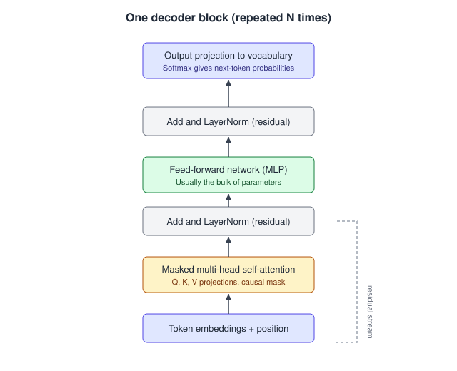

# 01. LLM fundamentals and architecture

109 questions. Sources are tagged per question. Full answers are in the linked source repo.

---

01.001  What is a token, and why does tokenization matter in practice?
> Source: LLM Q&A (aishwaryanr)

01.002  What is the context window, and what happens as you fill it?
> Source: LLM Q&A (aishwaryanr)

01.003  What do temperature and top-p control, and how do you set them?
> Source: LLM Q&A (aishwaryanr)

01.004  Why do LLMs hallucinate, and can you eliminate it?
> Source: LLM Q&A (aishwaryanr)

01.005  What is an embedding, and how is it used?
> Source: LLM Q&A (aishwaryanr)

01.006  At a high level, how does a transformer work, and what is self-attention doing?
> Source: LLM Q&A (aishwaryanr)

01.007  What is the difference between a base model, an instruction-tuned model, and a reasoning model?
> Source: LLM Q&A (aishwaryanr)

01.008  What is the difference between an LLM's parametric knowledge and non-parametric knowledge?
> Source: LLM Q&A (aishwaryanr)

01.009  What is a mixture-of-experts (MoE) model and why does it matter for AI Engineers?
> Source: LLM Q&A (aishwaryanr)

01.010  What is the KV cache, and why is it the reason generation gets faster after the first token?
> Source: LLM Q&A (aishwaryanr)

01.011  Why are LLMs bad at arithmetic and character-level tasks, and what do you do about it?
> Source: LLM Q&A (aishwaryanr)

01.012  How do you get a confidence or uncertainty signal out of an LLM?
> Source: LLM Q&A (aishwaryanr)

01.013  What is a training cutoff, and how does it shape product decisions?
> Source: LLM Q&A (aishwaryanr)

01.014  Are two identical calls to an LLM guaranteed to return the same output? Why does this matter?
> Source: LLM Q&A (aishwaryanr)

01.015  How does a multimodal (vision-language) model process an image, and what should you watch for?
> Source: LLM Q&A (aishwaryanr)

01.016  What is distillation, and why might you use a distilled model?
> Source: LLM Q&A (aishwaryanr)

01.017  Explain scaled dot-product attention and why the 1/sqrt(d_k) scaling factor matters.
> Asked at: LLM Internals and Architecture | Source: Company-wise (pallavi-shekhar)

01.018  What is the KV cache, and what are its memory implications at scale? Derive the formula.
> Asked at: Amazon, Apple, Character.AI, Mistral AI, NVIDIA, OpenAI, Together AI, xAI | Source: Company-wise (pallavi-shekhar)

01.019  What are Multi-Query Attention (MQA) and Grouped-Query Attention (GQA), and what do they trade away?
> Asked at: Meta, Mistral AI | Source: Company-wise (pallavi-shekhar)

01.020  What is Multi-head Latent Attention (MLA) and why did DeepSeek introduce it?
> Asked at: DeepSeek, Moonshot AI | Source: Company-wise (pallavi-shekhar)

01.021  Explain FlashAttention. It does not reduce FLOPs, so why is it faster?
> Asked at: Together AI | Source: Company-wise (pallavi-shekhar)

01.022  How does Byte Pair Encoding work, and what are its failure modes (numbers, code, non-Latin scripts)?
> Asked at: Alibaba, Hugging Face, Sarvam AI | Source: Company-wise (pallavi-shekhar)

01.023  What is positional encoding in transformers, and how has it evolved (sinusoidal → learned → RoPE → ALiBi)?
> Asked at: LLM Internals and Architecture | Source: Company-wise (pallavi-shekhar)

01.024  Explain RoPE and how position interpolation / YaRN extend context beyond the trained length.
> Asked at: Alibaba, Meta, Moonshot AI | Source: Company-wise (pallavi-shekhar)

01.025  What do the Chinchilla scaling laws say, and how do they differ from earlier scaling intuitions?
> Asked at: Anthropic | Source: Company-wise (pallavi-shekhar)

01.026  What is a mixture-of-experts architecture and how does it scale capacity without scaling FLOPs?
> Asked at: Alibaba, Cohere, DeepSeek, Mistral AI, Moonshot AI, Zhipu AI | Source: Company-wise (pallavi-shekhar)

01.027  Explain the difference between pre-training, supervised fine-tuning and preference optimisation.
> Asked at: Meta, Scale AI | Source: Company-wise (pallavi-shekhar)

01.028  Compare greedy, beam search, top-k, top-p and temperature sampling. When does each fail?
> Asked at: Apple, Google DeepMind, Perplexity | Source: Company-wise (pallavi-shekhar)

01.029  What is the lost-in-the-middle problem in long contexts and how do you address it?
> Asked at: Moonshot AI | Source: Company-wise (pallavi-shekhar)

01.030  Why is LayerNorm placed pre-block in modern transformers, and what is RMSNorm?
> Asked at: LLM Internals and Architecture | Source: Company-wise (pallavi-shekhar)

01.031  Explain SwiGLU and why gated activations replaced ReLU/GELU in modern LLM MLP blocks.
> Asked at: Meta | Source: Company-wise (pallavi-shekhar)

01.032  Walk me through what happens, tensor by tensor, in one forward pass of a decoder-only transformer.
> Asked at: Anthropic | Source: Company-wise (pallavi-shekhar)

01.033  What are the key components of a Transformer model and why does each matter?
> Asked at: Anthropic | Source: Company-wise (pallavi-shekhar)

01.034  Explain attention-free transformer architectures and their trade-offs.
> Asked at: Anthropic | Source: Company-wise (pallavi-shekhar)

01.035  Walk me through matrix manipulations relevant to LLM architectures.
> Asked at: Anthropic | Source: Company-wise (pallavi-shekhar)

01.036  Compute the KL divergence given different random variables.
> Asked at: OpenAI | Source: Company-wise (pallavi-shekhar)

01.037  If the accuracy of a classifier is 1, what is the lower/upper bound on the loss function for a single training example?
> Asked at: OpenAI | Source: Company-wise (pallavi-shekhar)

01.038  We have two models, 85% and 82% accuracy. Which do you pick?
> Asked at: OpenAI | Source: Company-wise (pallavi-shekhar)

01.039  How do you handle missing data in Pandas?
> Asked at: OpenAI | Source: Company-wise (pallavi-shekhar)

01.040  Explain self-attention. What is its computational complexity, and what are your options when contexts get long?
> Asked at: OpenAI | Source: Company-wise (pallavi-shekhar)

01.041  What is the relationship between cross-entropy, KL divergence and perplexity, and why is cross-entropy the training loss for language models?
> Asked at: OpenAI | Source: Company-wise (pallavi-shekhar)

01.042  What is the effect of adjusting an LLM's context window size?
> Asked at: OpenAI | Source: Company-wise (pallavi-shekhar)

01.043  Define the bias-variance trade-off and discuss the relationship between the two.
> Asked at: Google DeepMind and Google AI | Source: Company-wise (pallavi-shekhar)

01.044  What are the assumptions of linear regression?
> Asked at: Google DeepMind and Google AI | Source: Company-wise (pallavi-shekhar)

01.045  Distinguish regularization from validation: when is each the right tool?
> Asked at: Google DeepMind and Google AI | Source: Company-wise (pallavi-shekhar)

01.046  Derive the gradient of cross-entropy loss with softmax inputs, and explain why we fuse them numerically.
> Asked at: Google DeepMind and Google AI | Source: Company-wise (pallavi-shekhar)

01.047  Explain the SVD and give two places it shows up in modern deep learning.
> Asked at: Google DeepMind and Google AI | Source: Company-wise (pallavi-shekhar)

01.048  On average, how many fair coin flips until you see two heads in a row? Walk me through it.
> Asked at: Google DeepMind and Google AI | Source: Company-wise (pallavi-shekhar)

01.049  When would you choose Q-learning over policy gradients, and vice versa?
> Asked at: Google DeepMind and Google AI | Source: Company-wise (pallavi-shekhar)

01.050  You have a binary loan-approval classifier and limited access to feature weights. How do you explain a rejection?
> Asked at: Google DeepMind and Google AI | Source: Company-wise (pallavi-shekhar)

01.051  Your ads CTR model shows a 2% offline AUC gain, but the online A/B is revenue-neutral with worse calibration. What is going on, and what do you do?
> Asked at: Meta | Source: Company-wise (pallavi-shekhar)

01.052  Explain the architectural choices in a Llama-class model: why grouped-query attention, RoPE and SwiGLU instead of the vanilla 2017 Transformer?
> Asked at: Meta | Source: Company-wise (pallavi-shekhar)

01.053  What breaks when you scale LLM training from 8 GPUs to thousands, and how do modern stacks deal with it?
> Asked at: Meta | Source: Company-wise (pallavi-shekhar)

01.054  Mistral 7B shipped with grouped-query attention and sliding-window attention. What does each buy you, and what does each cost?
> Asked at: Mistral AI | Source: Company-wise (pallavi-shekhar)

01.055  Explain how a Mixtral-style sparse mixture-of-experts model works. Why does a ~47B-parameter model run at roughly the cost of a ~13B one?
> Asked at: Mistral AI | Source: Company-wise (pallavi-shekhar)

01.056  Our flagship is a sparse MoE with ~10x more total than active parameters. Why is that architecture a good fit for private enterprise deployment, and where does it hurt?
> Asked at: Cohere | Source: Company-wise (pallavi-shekhar)

01.057  Walk me through DeepSeekMoE. How is it different from a standard top-2 MoE like Mixtral?
> Asked at: DeepSeek | Source: Company-wise (pallavi-shekhar)

01.058  DeepSeek-V3 uses auxiliary-loss-free load balancing. What was wrong with the auxiliary loss, and how does the bias trick work?
> Asked at: DeepSeek | Source: Company-wise (pallavi-shekhar)

01.059  What is multi-token prediction (MTP) and why train with it?
> Asked at: DeepSeek | Source: Company-wise (pallavi-shekhar)

01.060  Implement top-k MoE routing with a shared expert in PyTorch, and point out the efficiency and correctness traps.
> Asked at: DeepSeek | Source: Company-wise (pallavi-shekhar)

01.061  Kimi's headline feature is very long context. When you push from 8K to hundreds of thousands of tokens, what actually breaks first, and why?
> Asked at: Moonshot AI | Source: Company-wise (pallavi-shekhar)

01.062  Kimi K2 uses Multi-head Latent Attention (MLA). Explain what it does and how it compares to GQA for KV-cache reduction.
> Asked at: Moonshot AI | Source: Company-wise (pallavi-shekhar)

01.063  Kimi K2 is a 1T-parameter MoE with ~32B active per token and hundreds of experts. Explain the routing and the systems cost of training it.
> Asked at: Moonshot AI | Source: Company-wise (pallavi-shekhar)

01.064  How do you take a model trained at 8K–32K and make it work at 128K or more?
> Asked at: Moonshot AI | Source: Company-wise (pallavi-shekhar)

01.065  GLM's original pre-training objective is autoregressive blank infilling. How does it differ from BERT and GPT, and why did the team argue it unifies understanding and generation?
> Asked at: Zhipu AI | Source: Company-wise (pallavi-shekhar)

01.066  GLM-4.5 is an MoE with 355B total but 32B active parameters. Explain the economics: what does that split buy you and what does it cost?
> Asked at: Zhipu AI | Source: Company-wise (pallavi-shekhar)

01.067  Implement a top-k MoE router in PyTorch. Then contrast auxiliary-loss load balancing with a loss-free approach.
> Asked at: Zhipu AI | Source: Company-wise (pallavi-shekhar)

01.068  What is Multi-Token Prediction (MTP), why add an MTP layer, and how does it help at inference time?
> Asked at: Zhipu AI | Source: Company-wise (pallavi-shekhar)

01.069  GLM has been bilingual Chinese/English since GLM-130B. What changes in tokenization, data and evaluation when a model must serve both languages well?
> Asked at: Zhipu AI | Source: Company-wise (pallavi-shekhar)

01.070  Qwen uses byte-level BPE with a ~151K vocabulary, augmented for multilingual coverage and with digits split into single characters. Why those choices, and what are the trade-offs?
> Asked at: Alibaba | Source: Company-wise (pallavi-shekhar)

01.071  Qwen3 unifies a thinking mode and a non-thinking mode in one model with a caller-settable thinking budget. How would you train that, and how would you serve it?
> Asked at: Alibaba | Source: Company-wise (pallavi-shekhar)

01.072  Qwen ships both dense and MoE models (30B with ~3B active; 235B with ~22B active). When would you pick the 30B-A3B MoE over a 32B dense?
> Asked at: Alibaba | Source: Company-wise (pallavi-shekhar)

01.073  Qwen2.5 extends context to 128K (and ~1M for Turbo) using YaRN plus Dual Chunk Attention, mostly training-free. Explain how, and why post-hoc extension is attractive.
> Asked at: Alibaba | Source: Company-wise (pallavi-shekhar)

01.074  Why is tokenization the first bottleneck for Indian-language LLMs, and how does a low-fertility tokenizer change the economics?
> Asked at: Sarvam AI | Source: Company-wise (pallavi-shekhar)

01.075  What is the closed-form solution of linear regression, and when do you use gradient descent instead?
> Asked at: Amazon | Source: Company-wise (pallavi-shekhar)

01.076  What are the differences between L1 and L2 regularization in logistic regression?
> Asked at: Amazon | Source: Company-wise (pallavi-shekhar)

01.077  Write the loss function for logistic regression and prove it has a global minimum.
> Asked at: Amazon | Source: Company-wise (pallavi-shekhar)

01.078  How is KL divergence loss different from cross-entropy loss? And from contrastive loss?
> Asked at: Amazon | Source: Company-wise (pallavi-shekhar)

01.079  How do bagging and boosting differ? What is the computational difference between XGBoost and Random Forest?
> Asked at: Amazon | Source: Company-wise (pallavi-shekhar)

01.080  Explain the bias-variance trade-off, cross-validation, and the curse of dimensionality.
> Asked at: Amazon | Source: Company-wise (pallavi-shekhar)

01.081  How do GRU cells work, and how do they address the vanishing gradient problem? How does a BiLSTM work?
> Asked at: Amazon | Source: Company-wise (pallavi-shekhar)

01.082  What is Attention in machine learning models? What happens in a neural network if you remove all the hidden layers?
> Asked at: Amazon | Source: Company-wise (pallavi-shekhar)

01.083  Discuss precision, recall and F1: when would you prioritise one over the others?
> Asked at: Amazon | Source: Company-wise (pallavi-shekhar)

01.084  How do you handle data imbalance, collinearity, feature selection and regularization?
> Asked at: Amazon | Source: Company-wise (pallavi-shekhar)

01.085  Explain how you would design and evaluate an A/B test. What is a p-value and how do you interpret it here?
> Asked at: Amazon | Source: Company-wise (pallavi-shekhar)

01.086  What is Maximum Likelihood Estimation and how does it differ from Bayesian inference?
> Asked at: Amazon | Source: Company-wise (pallavi-shekhar)

01.087  Why did transformers displace RNNs for language modelling, and what exactly does the KV cache buy you at inference time?
> Asked at: Amazon | Source: Company-wise (pallavi-shekhar)

01.088  Explain strategies to combat overfitting in tree-based classification models.
> Asked at: NVIDIA | Source: Company-wise (pallavi-shekhar)

01.089  Summarize the differences and benefits of the Adam optimizer compared with other methods for neural-network image classification.
> Asked at: NVIDIA | Source: Company-wise (pallavi-shekhar)

01.090  A network confuses pugs and pit bulls and some training labels are wrong. How do you modify the model and the data?
> Asked at: NVIDIA | Source: Company-wise (pallavi-shekhar)

01.091  How do you evaluate a clustering model's effectiveness without pre-labelled groups?
> Asked at: NVIDIA | Source: Company-wise (pallavi-shekhar)

01.092  How would you design the neural network architecture for multi-camera 3D object detection without lidar?
> Asked at: Tesla | Source: Company-wise (pallavi-shekhar)

01.093  How do you handle extreme class imbalance in rare-event detection (e.g. a child running into the road)?
> Asked at: Tesla | Source: Company-wise (pallavi-shekhar)

01.094  Explain how you would auto-label a fleet dataset and what quality controls you would put on it.
> Asked at: Tesla | Source: Company-wise (pallavi-shekhar)

01.095  How would you detect and handle distribution shift between fleet data and your training set?
> Asked at: Tesla | Source: Company-wise (pallavi-shekhar)

01.096  Your offline metric improved but the online A/B did not. Enumerate the reasons this happens and how you would tell them apart.
> Asked at: Consumer-Scale ML Companies | Source: Company-wise (pallavi-shekhar)

01.097  Explain position bias in ranking data and how you would debias training.
> Asked at: Consumer-Scale ML Companies | Source: Company-wise (pallavi-shekhar)

01.098  How do you design a feature store, and what causes training/serving skew?
> Asked at: Consumer-Scale ML Companies | Source: Company-wise (pallavi-shekhar)

01.099  Walk me through what actually happens when someone calls AutoModelForCausalLM.from_pretrained(…, device_map=“auto”, torch_dtype=“auto”).
> Asked at: Hugging Face | Source: Company-wise (pallavi-shekhar)

01.100  Compare BPE, WordPiece and Unigram tokenization. Why is `tokenizers` written in Rust, and what tokenizer bugs bite people in practice?
> Asked at: Hugging Face | Source: Company-wise (pallavi-shekhar)

01.101  What problem do chat templates solve, and what goes wrong when they're ignored?
> Asked at: Hugging Face | Source: Company-wise (pallavi-shekhar)

01.102  A conversation runs past the context window. What do you keep, and how do you decide?
> Asked at: Character.AI | Source: Company-wise (pallavi-shekhar)

01.103  Turn a conversation into billable diagnosis codes. What is the accuracy bar, and how do you build to it?
> Asked at: Abridge | Source: Company-wise (pallavi-shekhar)

01.104  Behaviour cloning on teleoperation data has a well-known failure mode. What is it, and what do you do about it on a real humanoid?
> Asked at: Figure AI | Source: Company-wise (pallavi-shekhar)

01.105  A whole-body controller trained entirely in simulation has to run on real hardware. What transfers, what does not, and how do you close the gap?
> Asked at: Figure AI | Source: Company-wise (pallavi-shekhar)

01.106  Where does reinforcement learning fit on top of imitation learning for manipulation, and what makes the reward the hard part?
> Asked at: Figure AI | Source: Company-wise (pallavi-shekhar)

01.107  Modular perception, prediction and planning, or end-to-end learned driving? Make the case, then tell me what you would actually build.
> Asked at: Waymo | Source: Company-wise (pallavi-shekhar)

01.108  Design the output representation for a behaviour prediction model. What metrics would you gate it on?
> Asked at: Waymo | Source: Company-wise (pallavi-shekhar)

01.109  Where do vision-language models and foundation models genuinely help in an autonomy stack, and where are they a liability?
> Asked at: Waymo | Source: Company-wise (pallavi-shekhar)

