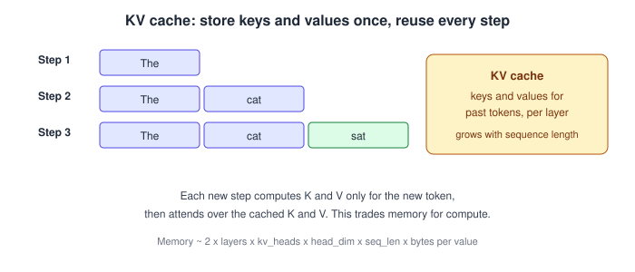
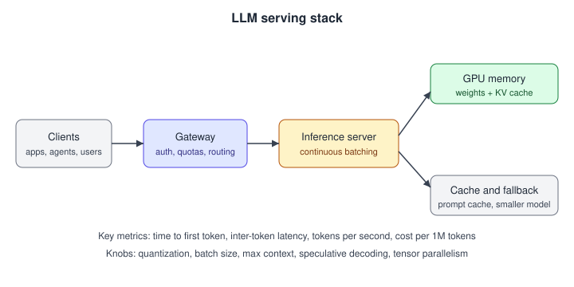
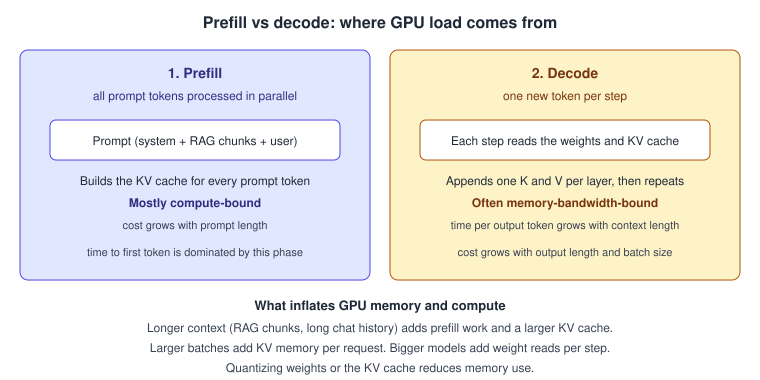

# 02. Inference, serving and cost

70 questions. Sources are tagged per question. Full answers are in the linked source repo.

---

02.001  How would you keep an LLM feature's cost and latency under control?
> Source: LLM Q&A (aishwaryanr)

02.002  Explain the latency-throughput-cost triangle and the main dials you have.
> Source: LLM Q&A (aishwaryanr)

02.003  What is prompt caching / KV caching and when does it help?
> Source: LLM Q&A (aishwaryanr)

02.004  How do you decide which model to use for a given step (model routing)?
> Source: LLM Q&A (aishwaryanr)

02.005  How does quantization affect an AI Engineer's decisions, even if you do not train models?
> Source: LLM Q&A (aishwaryanr)

02.006  What does observability look like for an LLM application in production?
> Source: LLM Q&A (aishwaryanr)

02.007  What is the difference between time-to-first-token and inter-token latency, and why care?
> Source: LLM Q&A (aishwaryanr)

02.008  What is semantic caching, and how is it different from prompt caching?
> Source: LLM Q&A (aishwaryanr)

02.009  What is speculative decoding, and why might it matter to you?
> Source: LLM Q&A (aishwaryanr)

02.010  What is continuous (in-flight) batching, and how does it change throughput?
> Source: LLM Q&A (aishwaryanr)

02.011  API prices have dropped sharply. How should that change your architecture decisions?
> Source: LLM Q&A (aishwaryanr)

02.012  How do you attribute and monitor LLM cost per feature or per user?
> Source: LLM Q&A (aishwaryanr)

02.013  When do you self-host an open-weight model instead of using a hosted API?
> Source: LLM Q&A (aishwaryanr)

02.014  How do you set up a safe fallback when a model call fails, times out, or is rate-limited?
> Source: LLM Q&A (aishwaryanr)

02.015  Explain the prefill and decode phases. Why is prefill compute-bound and decode memory-bandwidth-bound?
> Asked at: Moonshot AI, NVIDIA, Together AI | Source: Company-wise (pallavi-shekhar)

02.016  What is continuous (in-flight) batching and why did it replace static batching?
> Asked at: Anthropic, Mistral AI, NVIDIA, Together AI, xAI | Source: Company-wise (pallavi-shekhar)

02.017  How does PagedAttention work, and what problem of KV-cache fragmentation does it solve?
> Asked at: NVIDIA, Together AI | Source: Company-wise (pallavi-shekhar)

02.018  What is speculative decoding? Why is output quality preserved, and when does it not help?
> Asked at: NVIDIA, Together AI | Source: Company-wise (pallavi-shekhar)

02.019  Explain prefix caching / prompt caching. When should you use it, and what invalidates a cached prefix?
> Asked at: Character.AI, Moonshot AI | Source: Company-wise (pallavi-shekhar)

02.020  Compare FP16, BF16, FP8, INT8, INT4 and FP4 for serving. What breaks at each step down?
> Asked at: Apple, Character.AI, Mistral AI, NVIDIA, Together AI | Source: Company-wise (pallavi-shekhar)

02.021  Compare tensor, pipeline, data, sequence and expert parallelism. When do you combine them?
> Asked at: Amazon, Google DeepMind, Meta, NVIDIA | Source: Company-wise (pallavi-shekhar)

02.022  Estimate the GPU memory needed to serve a 70B model: weights, KV cache, activations, fragmentation.
> Asked at: NVIDIA | Source: Company-wise (pallavi-shekhar)

02.023  What are TTFT, TPOT, ITL and throughput, and how do they trade against each other?
> Asked at: Apple, Microsoft, Perplexity | Source: Company-wise (pallavi-shekhar)

02.024  Do the roofline maths: how many tokens/sec can one H100 produce for a 70B model at batch size 1?
> Asked at: NVIDIA, Together AI | Source: Company-wise (pallavi-shekhar)

02.025  When would you choose vLLM vs SGLang vs TensorRT-LLM vs a custom stack?
> Asked at: NVIDIA, Together AI | Source: Company-wise (pallavi-shekhar)

02.026  How would you cut LLM serving cost by 10x? Enumerate every lever and rank them.
> Asked at: Amazon, Cursor, Microsoft, NVIDIA | Source: Company-wise (pallavi-shekhar)

02.027  Your p99 latency doubled after a deploy with no model change. Walk through the diagnosis.
> Asked at: Amazon, Databricks, OpenAI, Perplexity | Source: Company-wise (pallavi-shekhar)

02.028  What is chunked prefill, and why does it improve tail latency under mixed traffic?
> Asked at: Inference, Serving and GPU Performance | Source: Company-wise (pallavi-shekhar)

02.029  Explain disaggregated prefill/decode serving and when it pays for itself.
> Asked at: Groq, Moonshot AI | Source: Company-wise (pallavi-shekhar)

02.030  Design a batched inference system where 100 requests take the same time as 1.
> Asked at: Anthropic | Source: Company-wise (pallavi-shekhar)

02.031  Design the serving stack for a Claude-scale LLM API. Maximise GPU utilisation without wrecking p99 latency.
> Asked at: Anthropic | Source: Company-wise (pallavi-shekhar)

02.032  You need to serve a Llama-class 70B+ model to hundreds of millions of assistant users. What does the serving stack look like and where does the money go?
> Asked at: Meta | Source: Company-wise (pallavi-shekhar)

02.033  Estimate the KV-cache memory to serve a 70B-class model at 128k context. What do you do when it doesn't fit?
> Asked at: xAI | Source: Company-wise (pallavi-shekhar)

02.034  Design a rate limiter for an LLM API where cost scales with tokens, not requests.
> Asked at: xAI | Source: Company-wise (pallavi-shekhar)

02.035  Estimate the KV-cache memory for serving Mistral 7B, and design the rolling-buffer cache that sliding-window attention enables.
> Asked at: Mistral AI | Source: Company-wise (pallavi-shekhar)

02.036  You need to quantize a model for a customer's hardware. How do you choose a scheme, and how do you prove quality hasn't regressed?
> Asked at: Mistral AI | Source: Company-wise (pallavi-shekhar)

02.037  Sketch how you would serve a 671B-parameter MoE model with low latency under GPU-memory constraints.
> Asked at: DeepSeek | Source: Company-wise (pallavi-shekhar)

02.038  Walk me through why you would disaggregate prefill and decode onto separate machines, as Mooncake does. What does that buy you and what does it cost?
> Asked at: Moonshot AI | Source: Company-wise (pallavi-shekhar)

02.039  A chat assistant re-sends a long conversation history on every turn. How do you avoid recomputing all of it, and what are the pitfalls?
> Asked at: Moonshot AI | Source: Company-wise (pallavi-shekhar)

02.040  How do you deploy a capable assistant on cost-sensitive or on-device hardware without a datacentre GPU? Walk through the efficiency toolkit.
> Asked at: Sarvam AI | Source: Company-wise (pallavi-shekhar)

02.041  A Copilot chat feature has a p95 budget of 3 seconds to first useful content. Where does the time go, and how do you cut it?
> Asked at: Microsoft | Source: Company-wise (pallavi-shekhar)

02.042  Estimate the annual serving cost of adding an LLM summary feature for 100 million weekly active users, and how you'd cut it by 10x.
> Asked at: Microsoft | Source: Company-wise (pallavi-shekhar)

02.043  A customer's Bedrock-hosted workload costs too much. Cut inference cost dramatically without unacceptable quality loss.
> Asked at: Amazon | Source: Company-wise (pallavi-shekhar)

02.044  You need to run a ~3B-parameter language model on a phone with tight memory and power budgets. What changes versus serving the same model in a datacenter?
> Asked at: Apple | Source: Company-wise (pallavi-shekhar)

02.045  Explain post-training quantization versus quantization-aware training. What breaks when you push weights to 2–4 bits, and how do you recover quality?
> Asked at: Apple | Source: Company-wise (pallavi-shekhar)

02.046  Estimate the KV-cache memory for a 3B on-device model at 4k context, and name the levers that shrink it.
> Asked at: Apple | Source: Company-wise (pallavi-shekhar)

02.047  Time-to-first-token for your on-device feature is 1.8 s. Walk me through diagnosing and fixing it.
> Asked at: Apple | Source: Company-wise (pallavi-shekhar)

02.048  You want to serve a 70B-parameter model on a single 80 GB GPU. Walk me through whether it fits and what single-stream tokens/sec you'd expect.
> Asked at: NVIDIA | Source: Company-wise (pallavi-shekhar)

02.049  What does TensorRT / TensorRT-LLM actually do to a model to make it faster, and when will it not help?
> Asked at: NVIDIA | Source: Company-wise (pallavi-shekhar)

02.050  Design the parallelism strategy for serving a 405B-parameter dense model. TP, PP, EP: what goes where and why?
> Asked at: NVIDIA | Source: Company-wise (pallavi-shekhar)

02.051  The onboard compute budget is fixed. Walk me through quantizing and pruning a vision model without losing recall on small objects.
> Asked at: Tesla | Source: Company-wise (pallavi-shekhar)

02.052  An LPU has no HBM at all, just on-die SRAM. Redo the decode roofline argument for that machine and tell me what changes.
> Asked at: Groq | Source: Company-wise (pallavi-shekhar)

02.053  A 70B dense model at 8-bit weights, chips with ~230 MB of SRAM each. Walk me through the deployment and the unit economics.
> Asked at: Groq | Source: Company-wise (pallavi-shekhar)

02.054  On a GPU you batch to amortise weight reads. What is the batching calculus on an SRAM-only machine, and how should that change how we price?
> Asked at: Groq | Source: Company-wise (pallavi-shekhar)

02.055  Determinism is the headline claim. What does it actually buy at p99, and why does it matter especially for agentic workloads?
> Asked at: Groq | Source: Company-wise (pallavi-shekhar)

02.056  How would you serve a large mixture-of-experts model on a statically scheduled fabric when expert selection is data-dependent?
> Asked at: Groq | Source: Company-wise (pallavi-shekhar)

02.057  Design the scheduler for a continuous-batching inference engine.
> Asked at: Together AI | Source: Company-wise (pallavi-shekhar)

02.058  Explain speculative decoding. When does it help, when does it hurt, and why adapt the speculator to live traffic?
> Asked at: Together AI | Source: Company-wise (pallavi-shekhar)

02.059  Price a dedicated endpoint: estimate cost per million output tokens for a 70B model, and explain the throughput-latency trade.
> Asked at: Together AI | Source: Company-wise (pallavi-shekhar)

02.060  p95 time-to-first-token regressed from 1.2 s to 3 s after a release. Walk me through finding and fixing it.
> Asked at: Perplexity | Source: Company-wise (pallavi-shekhar)

02.061  Serving a custom completion model to millions of DAU: walk me through the inference-cost model and your top three levers.
> Asked at: Cursor | Source: Company-wise (pallavi-shekhar)

02.062  Walk me through the latency budget of a query: query understanding → retrieval → rerank → LLM answer. Where do you spend and where do you cut?
> Asked at: Glean | Source: Company-wise (pallavi-shekhar)

02.063  Our serving cost is dominated by KV cache, not weights. Get it down by an order of magnitude and tell me what you give up.
> Asked at: Character.AI | Source: Company-wise (pallavi-shekhar)

02.064  Dialogues here average around 180 messages. Design the cache that sits between turns.
> Asked at: Character.AI | Source: Company-wise (pallavi-shekhar)

02.065  You train natively in int8 rather than doing post-training quantization. Defend that.
> Asked at: Character.AI | Source: Company-wise (pallavi-shekhar)

02.066  Estimate what one message costs us to serve, and tell me which lever moves it most.
> Asked at: Character.AI | Source: Company-wise (pallavi-shekhar)

02.067  Serving real-time TTS is a different capacity problem from serving a text LLM. Why, and how do you plan capacity?
> Asked at: ElevenLabs | Source: Company-wise (pallavi-shekhar)

02.068  The note should be ready before the clinician leaves the room. Build me the latency budget, and tell me where the money goes.
> Asked at: Abridge | Source: Company-wise (pallavi-shekhar)

02.069  A colleague wants to move the semantic layer to the cloud so you can use a much bigger model. Walk me through the latency budget.
> Asked at: Figure AI | Source: Company-wise (pallavi-shekhar)

02.070  Budget the compute and latency for the onboard stack. What breaks when a model gets bigger?
> Asked at: Waymo | Source: Company-wise (pallavi-shekhar)

