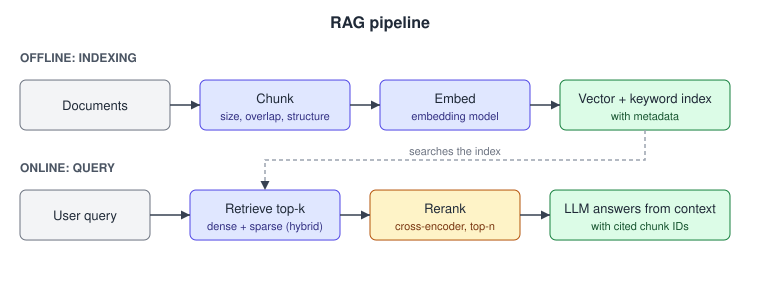

# 04. RAG and retrieval

52 questions. Sources are tagged per question. Full answers are in the linked source repo.

---

04.001  When would you use RAG instead of fine-tuning to give a model new knowledge?
> Source: LLM Q&A (aishwaryanr)

04.002  Walk me through a basic RAG pipeline end to end.
> Source: LLM Q&A (aishwaryanr)

04.003  How do you choose a chunking strategy?
> Source: LLM Q&A (aishwaryanr)

04.004  What is the difference between dense, sparse, and hybrid retrieval?
> Source: LLM Q&A (aishwaryanr)

04.005  What does a reranker do, and when is it worth it?
> Source: LLM Q&A (aishwaryanr)

04.006  Why might a model answer worse with retrieved context than with none?
> Source: LLM Q&A (aishwaryanr)

04.007  How do you evaluate a RAG system?
> Source: LLM Q&A (aishwaryanr)

04.008  What is the RAG triad?
> Source: LLM Q&A (aishwaryanr)

04.009  What is agentic RAG, and when do you need it?
> Source: LLM Q&A (aishwaryanr)

04.010  What is GraphRAG and what problem does it solve?
> Source: LLM Q&A (aishwaryanr)

04.011  How does RAG change at enterprise scale?
> Source: LLM Q&A (aishwaryanr)

04.012  How do you handle document freshness and updates in a RAG index?
> Source: LLM Q&A (aishwaryanr)

04.013  A user asks something your corpus does not cover. What should the system do, and how do you make it do that?
> Source: LLM Q&A (aishwaryanr)

04.014  What is contextual retrieval, and what problem does it fix?
> Source: LLM Q&A (aishwaryanr)

04.015  What is late chunking, and how does it differ from contextual retrieval?
> Source: LLM Q&A (aishwaryanr)

04.016  What is query rewriting or HyDE, and when does it help retrieval?
> Source: LLM Q&A (aishwaryanr)

04.017  How does metadata filtering improve retrieval, and how do you use it?
> Source: LLM Q&A (aishwaryanr)

04.018  How do you choose a vector index (for example HNSW vs IVF vs flat) and does it matter?
> Source: LLM Q&A (aishwaryanr)

04.019  With million-token context windows, is RAG obsolete? When do you still need it?
> Source: LLM Q&A (aishwaryanr)

04.020  How do you do RAG over tables, PDFs, and images rather than clean text?
> Source: LLM Q&A (aishwaryanr)

04.021  What is query routing across multiple indices or data sources?
> Source: LLM Q&A (aishwaryanr)

04.022  How do you build a golden evaluation set for a RAG system from real usage?
> Source: LLM Q&A (aishwaryanr)

04.023  How do you tune the retrieval score threshold that decides answerable vs unanswerable?
> Source: LLM Q&A (aishwaryanr)

04.024  How do you attach and verify citations so users can trust a RAG answer?
> Source: LLM Q&A (aishwaryanr)

04.025  What chunking strategy would you use for a large technical documentation corpus, and why?
> Asked at: Glean | Source: Company-wise (pallavi-shekhar)

04.026  How do you choose between a sparse retriever (BM25) and a dense retriever? When do you need both?
> Asked at: Glean, Microsoft, Perplexity | Source: Company-wise (pallavi-shekhar)

04.027  What is a reranker, when should you use one, and what does a cross-encoder cost you?
> Asked at: Cohere, Microsoft, Perplexity | Source: Company-wise (pallavi-shekhar)

04.028  How would you evaluate the quality of a RAG pipeline: retrieval and generation separately?
> Asked at: Cohere | Source: Company-wise (pallavi-shekhar)

04.029  What is HyDE (hypothetical document embeddings) and when does it outperform standard dense retrieval?
> Asked at: RAG and Retrieval | Source: Company-wise (pallavi-shekhar)

04.030  How does agentic RAG differ from standard RAG, and when is the extra complexity justified?
> Asked at: RAG and Retrieval | Source: Company-wise (pallavi-shekhar)

04.031  What causes semantic drift in embedding search and how do you detect it?
> Asked at: Cohere | Source: Company-wise (pallavi-shekhar)

04.032  Design permission-aware retrieval: users must never see content they can't access in the source system.
> Asked at: Databricks, Glean, Microsoft, Palantir | Source: Company-wise (pallavi-shekhar)

04.033  Compare HNSW, IVF-PQ and flat indexes. How do you pick, and what does recall@k cost in latency?
> Asked at: RAG and Retrieval | Source: Company-wise (pallavi-shekhar)

04.034  How do you handle tables, figures and multi-column PDFs in a retrieval pipeline?
> Asked at: RAG and Retrieval | Source: Company-wise (pallavi-shekhar)

04.035  How do you keep an index fresh when the underlying corpus changes continuously?
> Asked at: Cursor, Perplexity | Source: Company-wise (pallavi-shekhar)

04.036  How do you attribute every claim in a generated answer to a specific retrieved span?
> Asked at: Abridge, Harvey, Perplexity | Source: Company-wise (pallavi-shekhar)

04.037  You have an embedding model and a reranker. Why sell both? Design the two-stage retrieval pipeline and tell me when the reranker earns its latency.
> Asked at: Cohere | Source: Company-wise (pallavi-shekhar)

04.038  An enterprise wants semantic search over ~100M documents but is balking at vector-index cost. Walk me through embedding compression options and the maths.
> Asked at: Cohere | Source: Company-wise (pallavi-shekhar)

04.039  How would you evaluate multilingual retrieval quality when employees query in French and Korean over mostly-English documents?
> Asked at: Cohere | Source: Company-wise (pallavi-shekhar)

04.040  A customer 10x'd their indexed documents and reports answer quality “got noticeably worse.” Drive the investigation.
> Asked at: Cohere | Source: Company-wise (pallavi-shekhar)

04.041  For a long-context assistant, when is a 1M-token context window the right tool, and when should you use retrieval instead?
> Asked at: Moonshot AI | Source: Company-wise (pallavi-shekhar)

04.042  Design cross-lingual RAG: the knowledge base is in English and Hindi, but users ask in Tamil, Telugu or transliterated Hinglish.
> Asked at: Sarvam AI | Source: Company-wise (pallavi-shekhar)

04.043  Discuss reranker architecture choices: cross-encoder, ColBERT, LLM-based.
> Asked at: Perplexity | Source: Company-wise (pallavi-shekhar)

04.044  You retrieved 50 candidate passages but the model's useful context budget is ~10. How do you choose, and how do you know your choices are good?
> Asked at: Perplexity | Source: Company-wise (pallavi-shekhar)

04.045  Long context windows keep getting cheaper. Why not drop retrieval and stuff the whole repo into context for every request?
> Asked at: Cursor | Source: Company-wise (pallavi-shekhar)

04.046  The agent answers from a customer's knowledge base, which contains outdated and contradictory articles. How do you prevent confidently wrong answers?
> Asked at: Sierra | Source: Company-wise (pallavi-shekhar)

04.047  A lawyer asks about a 200-page credit agreement where the operative clause on page 140 depends on a defined term on page 8. How do you build retrieval that gets this right?
> Asked at: Harvey | Source: Company-wise (pallavi-shekhar)

04.048  When would you put a whole contract in the context window instead of retrieving over it? Defend the answer with numbers.
> Asked at: Harvey | Source: Company-wise (pallavi-shekhar)

04.049  How would you chunk and embed heterogeneous enterprise content: Slack threads, Jira tickets, Google Docs, PDFs?
> Asked at: Glean | Source: Company-wise (pallavi-shekhar)

04.050  Why is RAG the right architecture for an enterprise assistant instead of fine-tuning on the company's data? Where does RAG break?
> Asked at: Glean | Source: Company-wise (pallavi-shekhar)

04.051  The patient's chart already lists their medications. How would you use that to improve transcription of drug names, and how would you keep it from backfiring?
> Asked at: Abridge | Source: Company-wise (pallavi-shekhar)

04.052  Users ask “how many open orders are blocked on a supplier issue?” Plain RAG gets this wrong. Why, and what's the right architecture?
> Asked at: Palantir | Source: Company-wise (pallavi-shekhar)

