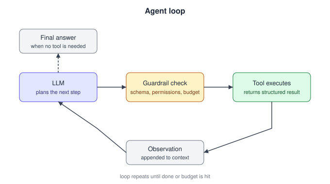

# 05. Agents and tool use

54 questions. Sources are tagged per question. Full answers are in the linked source repo.

---

05.001  What makes something an agent rather than a single LLM call, and when do you actually need one?
> Source: LLM Q&A (aishwaryanr)

05.002  Explain the ReAct pattern.
> Source: LLM Q&A (aishwaryanr)

05.003  How does function calling / tool use work under the hood?
> Source: LLM Q&A (aishwaryanr)

05.004  What is the Model Context Protocol (MCP) and why does it matter?
> Source: LLM Q&A (aishwaryanr)

05.005  How do you keep an agent from looping forever or running up cost?
> Source: LLM Q&A (aishwaryanr)

05.006  What is agent memory, and what types are there?
> Source: LLM Q&A (aishwaryanr)

05.007  When is a multi-agent system worth it over a single agent, and what are the risks?
> Source: LLM Q&A (aishwaryanr)

05.008  What is the difference between a workflow and an agent, and why prefer workflows when you can?
> Source: LLM Q&A (aishwaryanr)

05.009  How do you evaluate an agent, and why is average accuracy not enough?
> Source: LLM Q&A (aishwaryanr)

05.010  How would you design tools for an agent so it uses them reliably?
> Source: LLM Q&A (aishwaryanr)

05.011  What is the difference between planning-first and reactive (ReAct-style) agents?
> Source: LLM Q&A (aishwaryanr)

05.012  What is reflection or self-critique in an agent, and when does it actually help?
> Source: LLM Q&A (aishwaryanr)

05.013  How do you manage context in a long-horizon agent that runs for many steps?
> Source: LLM Q&A (aishwaryanr)

05.014  What is the orchestrator-worker (sub-agent) pattern, and how do sub-agents communicate?
> Source: LLM Q&A (aishwaryanr)

05.015  What is A2A (agent-to-agent) communication, and how does it relate to MCP?
> Source: LLM Q&A (aishwaryanr)

05.016  Why do agents fail on long tasks even when each step is likely to succeed?
> Source: LLM Q&A (aishwaryanr)

05.017  How do you decide how much autonomy to give an agent (the agency-control tradeoff)?
> Source: LLM Q&A (aishwaryanr)

05.018  How does an agentic coding harness (like a coding agent) work, and what makes it reliable?
> Source: LLM Q&A (aishwaryanr)

05.019  How do you handle handoff from an agent to a human?
> Source: LLM Q&A (aishwaryanr)

05.020  Explain the ReAct pattern and what it solves over chain-of-thought alone.
> Asked at: Agents and Tool Use | Source: Company-wise (pallavi-shekhar)

05.021  How do you handle tool-call errors, timeouts and retries in an agentic loop?
> Asked at: Cognition, OpenAI | Source: Company-wise (pallavi-shekhar)

05.022  What is the difference between structured output and function calling?
> Asked at: Apple, Mistral AI | Source: Company-wise (pallavi-shekhar)

05.023  What is MCP (Model Context Protocol) and how does it differ from traditional function calling?
> Asked at: Microsoft | Source: Company-wise (pallavi-shekhar)

05.024  How many tools is too many? How do you design tool schemas an LLM can actually use correctly?
> Asked at: Anthropic, Cognition | Source: Company-wise (pallavi-shekhar)

05.025  How does multi-agent orchestration work, and when does it break down?
> Asked at: Cognition | Source: Company-wise (pallavi-shekhar)

05.026  Design memory for a long-running agent: what do you store, where, and how do you retrieve it?
> Asked at: Anthropic | Source: Company-wise (pallavi-shekhar)

05.027  How does an agent decide when to call a tool versus answer from its own knowledge?
> Asked at: Agents and Tool Use | Source: Company-wise (pallavi-shekhar)

05.028  What makes an agent loop terminate correctly? How do you bound cost and steps?
> Asked at: Agents and Tool Use | Source: Company-wise (pallavi-shekhar)

05.029  How do you make an agent's actions reversible, or at least auditable, in a production system?
> Asked at: Palantir | Source: Company-wise (pallavi-shekhar)

05.030  Design human-in-the-loop approval for an agent that takes consequential actions.
> Asked at: OpenAI, Palantir | Source: Company-wise (pallavi-shekhar)

05.031  Your agent drifts after a long run and confidently works on the wrong thing. Diagnose it.
> Asked at: Cognition | Source: Company-wise (pallavi-shekhar)

05.032  What matters more for an agentic coding tool like Claude Code: the model or the harness? Design the loop.
> Asked at: Anthropic | Source: Company-wise (pallavi-shekhar)

05.033  Design the tool surface for a coding agent: which tools exist, what their schemas look like, and how results come back.
> Asked at: Anthropic | Source: Company-wise (pallavi-shekhar)

05.034  You are building a production agent that calls tools (function calling). What makes the loop reliable enough to ship?
> Asked at: OpenAI | Source: Company-wise (pallavi-shekhar)

05.035  You're dropped into an unfamiliar multi-file codebase with a failing behaviour and an LLM assistant available. Walk me through how you'd fix it.
> Asked at: Meta | Source: Company-wise (pallavi-shekhar)

05.036  How does function calling actually work with an LLM, and how do you make it reliable enough for production agents?
> Asked at: Mistral AI | Source: Company-wise (pallavi-shekhar)

05.037  Design an agent that automates an enterprise workflow, say, drafting RFP responses from internal documents and a CRM. What does “enter-prise-grade” add?
> Asked at: Cohere | Source: Company-wise (pallavi-shekhar)

05.038  AutoGLM and CogAgent operate real GUIs from screenshots over tens of steps. Design the agent: perception, action space, and error recovery for a 50-step task.
> Asked at: Zhipu AI | Source: Company-wise (pallavi-shekhar)

05.039  Design an agent that operates a web browser to complete multi-step tasks. How do you make it reliable enough to ship?
> Asked at: Amazon | Source: Company-wise (pallavi-shekhar)

05.040  Your on-device model must emit valid, schema-conforming tool calls. How do you guarantee validity rather than hope for it?
> Asked at: Apple | Source: Company-wise (pallavi-shekhar)

05.041  Design the harness for an agent that makes multi-file changes from a natural-language task. How do you keep it from wrecking a codebase?
> Asked at: Cursor | Source: Company-wise (pallavi-shekhar)

05.042  Design an agentic AI system that can autonomously adapt to new tasks.
> Asked at: Cursor | Source: Company-wise (pallavi-shekhar)

05.043  You have eight hours to build a coding agent from scratch. Describe what you build and, more importantly, what you cut.
> Asked at: Cognition | Source: Company-wise (pallavi-shekhar)

05.044  Cognition published an argument against multi-agent systems and later published what actually works. Reconcile those two positions.
> Asked at: Cognition | Source: Company-wise (pallavi-shekhar)

05.045  Your agent spends over half its first turn just finding the relevant code. How do you fix that?
> Asked at: Cognition | Source: Company-wise (pallavi-shekhar)

05.046  Design a customer-facing agent for an airline that can cancel and rebook flights. How do you keep it from violating fare policy?
> Asked at: Sierra | Source: Company-wise (pallavi-shekhar)

05.047  LLMs are non-deterministic, but a refund over $200 must never be auto-approved. Where's the line between prompting and code?
> Asked at: Sierra | Source: Company-wise (pallavi-shekhar)

05.048  Design the human-handoff path for a customer-service agent. When should it escalate, and what does a good handoff look like?
> Asked at: Sierra | Source: Company-wise (pallavi-shekhar)

05.049  Design an agent that takes a draft NDA and returns a redlined Word document reflecting the firm's playbook, not a chat response.
> Asked at: Harvey | Source: Company-wise (pallavi-shekhar)

05.050  Design an agent that takes actions in enterprise tools (file a Jira ticket, draft an email) on a user's behalf. How do you handle permissions and evaluate it?
> Asked at: Glean | Source: Company-wise (pallavi-shekhar)

05.051  Design agent orchestration across dozens of connected SaaS systems. Where is authorization enforced, and why can it not live in the model?
> Asked at: Glean | Source: Company-wise (pallavi-shekhar)

05.052  Design a service that turns the conversation into draft orders: labs, imaging, referrals, prescriptions, via tool calls against the EHR.
> Asked at: Abridge | Source: Company-wise (pallavi-shekhar)

05.053  What is an ontology in the Palantir sense, and why put LLM agents on top of one instead of on raw tables and documents?
> Asked at: Palantir | Source: Company-wise (pallavi-shekhar)

05.054  Design an LLM agent that files and updates work orders in a customer's ERP: real writes to a production system. How do you make that safe?
> Asked at: Palantir | Source: Company-wise (pallavi-shekhar)

