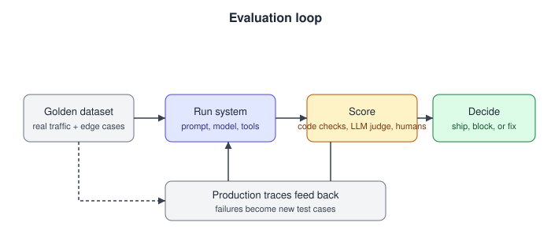

# 07. Evaluation and observability

63 questions. Sources are tagged per question. Full answers are in the linked source repo.

---

07.001  How do you evaluate an LLM feature that has no single correct answer (for example a summary or a draft reply)?
> Source: LLM Q&A (aishwaryanr)

07.002  What is LLM-as-judge, and what are its failure modes?
> Source: LLM Q&A (aishwaryanr)

07.003  What is reward hacking or eval gaming, and how do you guard against it?
> Source: LLM Q&A (aishwaryanr)

07.004  What is the difference between offline and online evaluation, and why do you need both?
> Source: LLM Q&A (aishwaryanr)

07.005  Why measure reliability such as pass^k for agents rather than just accuracy?
> Source: LLM Q&A (aishwaryanr)

07.006  How do you build an eval set from scratch for a new feature?
> Source: LLM Q&A (aishwaryanr)

07.007  What benchmarks or metrics would you actually cite, and how much do you trust them?
> Source: LLM Q&A (aishwaryanr)

07.008  What is error analysis, and why do practitioners call it the highest-leverage eval activity?
> Source: LLM Q&A (aishwaryanr)

07.009  What is eval-driven development, and how do you wire evals into CI?
> Source: LLM Q&A (aishwaryanr)

07.010  How do you calibrate an LLM judge, and what agreement level should you target?
> Source: LLM Q&A (aishwaryanr)

07.011  Pointwise vs pairwise judging: when do you use each?
> Source: LLM Q&A (aishwaryanr)

07.012  How do you evaluate a multi-turn conversational agent, not just single responses?
> Source: LLM Q&A (aishwaryanr)

07.013  What is drift, and how does online evaluation catch it that latency monitoring cannot?
> Source: LLM Q&A (aishwaryanr)

07.014  How do you run an A/B test for an LLM feature, and what do you measure?
> Source: LLM Q&A (aishwaryanr)

07.015  Why do public benchmarks saturate or mislead, and what is contamination?
> Source: LLM Q&A (aishwaryanr)

07.016  Design an LLM-as-judge evaluation. What are its known biases and how do you correct for them?
> Asked at: Perplexity | Source: Company-wise (pallavi-shekhar)

07.017  How do you build an eval set when there is no labelled ground truth and experts are expensive?
> Asked at: Cohere, Harvey | Source: Company-wise (pallavi-shekhar)

07.018  How do you detect and measure hallucinations in a production RAG system?
> Asked at: Anthropic, Cursor, OpenAI | Source: Company-wise (pallavi-shekhar)

07.019  Design the regression gate that decides whether a prompt or model change ships.
> Asked at: Anthropic | Source: Company-wise (pallavi-shekhar)

07.020  Why do benchmark scores improve while users say the system got worse? Enumerate the reasons.
> Asked at: Cognition | Source: Company-wise (pallavi-shekhar)

07.021  What is benchmark contamination and how do you guard against it?
> Asked at: Alibaba, Scale AI, Zhipu AI | Source: Company-wise (pallavi-shekhar)

07.022  What observability does a production LLM system need: traces, spans, costs, feedback?
> Asked at: Evaluation and Observability | Source: Company-wise (pallavi-shekhar)

07.023  How do you manage prompt versioning and rollbacks in production?
> Asked at: Evaluation and Observability | Source: Company-wise (pallavi-shekhar)

07.024  Design online evaluation: what do you log, what do you sample, and what do you A/B?
> Asked at: Perplexity | Source: Company-wise (pallavi-shekhar)

07.025  How would you evaluate an agent, as opposed to a single model response?
> Asked at: Cognition, Moonshot AI, Scale AI, Zhipu AI | Source: Company-wise (pallavi-shekhar)

07.026  How would you design an experiment to test for a specific emergent capability or bias in a large language model?
> Asked at: Anthropic | Source: Company-wise (pallavi-shekhar)

07.027  A customer says “the model got worse” after you upgraded model versions in their deployment. How do you verify and respond?
> Asked at: OpenAI | Source: Company-wise (pallavi-shekhar)

07.028  An enterprise customer reports that responses from your deployed system have gotten slow. Walk me through the diagnosis.
> Asked at: OpenAI | Source: Company-wise (pallavi-shekhar)

07.029  Build the evaluation harness for a new frontier model release. What does it need to do?
> Asked at: Google DeepMind and Google AI | Source: Company-wise (pallavi-shekhar)

07.030  Do 1 million Seattle ride trips suffice to build an accurate ETA prediction model? How would you decide?
> Asked at: Google DeepMind and Google AI | Source: Company-wise (pallavi-shekhar)

07.031  How would you build the evaluation system for a Meta AI assistant before and after each model release?
> Asked at: Meta | Source: Company-wise (pallavi-shekhar)

07.032  An enterprise customer wants to deploy your RAG system but has no labelled data. How do you evaluate it before and after launch?
> Asked at: Cohere | Source: Company-wise (pallavi-shekhar)

07.033  Kimi K2 targets agentic and coding tasks. How would you evaluate whether an agentic model is actually good, beyond a single benchmark number?
> Asked at: Moonshot AI | Source: Company-wise (pallavi-shekhar)

07.034  How would you evaluate an agentic coding model on SWE-bench and τ-bench style benchmarks without fooling yourself?
> Asked at: Zhipu AI | Source: Company-wise (pallavi-shekhar)

07.035  Qwen ships open weights that top public leaderboards. As the release engineer, how do you make sure the benchmark numbers are trustworthy and not contaminated?
> Asked at: Alibaba | Source: Company-wise (pallavi-shekhar)

07.036  How would you evaluate an Indic LLM properly? Why is running translated English benchmarks not enough?
> Asked at: Sarvam AI | Source: Company-wise (pallavi-shekhar)

07.037  How would you evaluate a meeting-summarisation feature before shipping it to a hundred million users?
> Asked at: Microsoft | Source: Company-wise (pallavi-shekhar)

07.038  How would you decide an LLM-powered assistant is ready to launch to millions of customers?
> Asked at: Amazon | Source: Company-wise (pallavi-shekhar)

07.039  You're shipping notification summarization to hundreds of millions of users in 30+ locales, and you cannot log user content. Design the evaluation and regression-detection story.
> Asked at: Apple | Source: Company-wise (pallavi-shekhar)

07.040  Disengagement rate is a weak proxy. How would you actually measure whether an autonomy release is safer than the last one?
> Asked at: Tesla | Source: Company-wise (pallavi-shekhar)

07.041  How do you monitor a deployed ranking model for drift, and what triggers a retrain?
> Asked at: Consumer-Scale ML Companies | Source: Company-wise (pallavi-shekhar)

07.042  Take a working GenAI agent prototype to production for an enterprise. What's your checklist between demo and launch?
> Asked at: Databricks | Source: Company-wise (pallavi-shekhar)

07.043  Your annotators have no ground truth: the tasks are subjective preference judgments. How do you measure and improve label quality?
> Asked at: Scale AI | Source: Company-wise (pallavi-shekhar)

07.044  How would you benchmark an LLM agent's tool use, say, for enterprise workflows composing 10+ APIs?
> Asked at: Scale AI | Source: Company-wise (pallavi-shekhar)

07.045  An eval pipeline you own suddenly reports a 6-point drop for a customer's model between Tuesday and Wednesday. The model didn't change. Debug it.
> Asked at: Scale AI | Source: Company-wise (pallavi-shekhar)

07.046  How would you evaluate answer quality for an answer engine, continuously and at scale, with both automated and human signals?
> Asked at: Perplexity | Source: Company-wise (pallavi-shekhar)

07.047  How do you evaluate a code-editing model before shipping it? Design the offline and online eval story for tab or agent edits.
> Asked at: Cursor | Source: Company-wise (pallavi-shekhar)

07.048  How would you evaluate an autonomous software engineering agent? Explain why SWE-bench pass rates mislead.
> Asked at: Cognition | Source: Company-wise (pallavi-shekhar)

07.049  The space of possible conversations is effectively infinite. How do you evaluate a conversational agent before launch?
> Asked at: Sierra | Source: Company-wise (pallavi-shekhar)

07.050  Your agent passes 92% of eval tasks. Why might that number be misleading, and what would you measure instead?
> Asked at: Sierra | Source: Company-wise (pallavi-shekhar)

07.051  After a foundation-model version upgrade, your production agent's escalation rate doubles overnight. Walk me through your response.
> Asked at: Sierra | Source: Company-wise (pallavi-shekhar)

07.052  A new frontier model is released and scores better on your benchmarks. What happens before it reaches customers?
> Asked at: Harvey | Source: Company-wise (pallavi-shekhar)

07.053  Design the evaluation framework for an enterprise AI assistant when you cannot look at customer data.
> Asked at: Glean | Source: Company-wise (pallavi-shekhar)

07.054  Users complain that characters drift out of persona after a long session. Diagnose it.
> Asked at: Character.AI | Source: Company-wise (pallavi-shekhar)

07.055  Engagement metrics and wellbeing metrics disagree. How do you build a system that resolves that?
> Asked at: Character.AI | Source: Company-wise (pallavi-shekhar)

07.056  Two good clinicians write different notes for the same visit. So how do you evaluate note quality at all?
> Asked at: Abridge | Source: Company-wise (pallavi-shekhar)

07.057  Edit rate is the obvious measure of clinician trust. What does it hide, and what would you instrument instead?
> Asked at: Abridge | Source: Company-wise (pallavi-shekhar)

07.058  How do you evaluate a manipulation policy when every trial costs robot time and every failure has physical consequences?
> Asked at: Figure AI | Source: Company-wise (pallavi-shekhar)

07.059  You ship a policy to 300 robots. It works in the lab and degrades in the field. Debug it.
> Asked at: Figure AI | Source: Company-wise (pallavi-shekhar)

07.060  Disengagement rate is a weak safety proxy. How would you actually measure whether the Driver is safe enough to ship?
> Asked at: Waymo | Source: Company-wise (pallavi-shekhar)

07.061  How do you build a simulator you would trust to gate a release?
> Asked at: Waymo | Source: Company-wise (pallavi-shekhar)

07.062  Two days before a release decision, simulation shows a 15% increase in hard-braking events in one scenario cluster. Walk me through what you do.
> Asked at: Waymo | Source: Company-wise (pallavi-shekhar)

07.063  How do you evaluate an LLM workflow before and after giving it access to production operations?
> Asked at: Palantir | Source: Company-wise (pallavi-shekhar)

