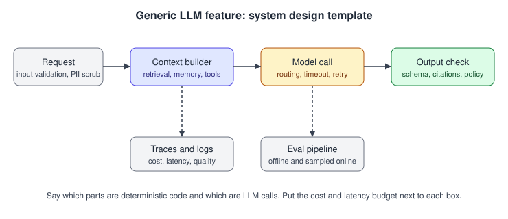

# 10. AI system design

93 questions. Sources are tagged per question. Full answers are in the linked source repo.

---

10.001  Design a customer support agent for an enterprise. Walk me through it.
> Source: LLM Q&A (aishwaryanr)

10.002  Design a RAG system over 10 million internal documents with per-user access control.
> Source: LLM Q&A (aishwaryanr)

10.003  Design the evaluation and monitoring system for an LLM feature already in production and getting hallucination complaints.
> Source: LLM Q&A (aishwaryanr)

10.004  Design an insurance-claims agent that ingests a claim and outputs approve, deny, or needs-review.
> Source: LLM Q&A (aishwaryanr)

10.005  How do you cut the p95 latency of a feature that makes one reasoning-model call per request?
> Source: LLM Q&A (aishwaryanr)

10.006  Design a code assistant that answers questions over a large private codebase with a 2-second latency budget.
> Source: LLM Q&A (aishwaryanr)

10.007  Design a multi-tenant LLM application. What is different from a single-tenant one?
> Source: LLM Q&A (aishwaryanr)

10.008  Design a document-processing pipeline that extracts structured data from messy PDFs at scale.
> Source: LLM Q&A (aishwaryanr)

10.009  You need to migrate a production feature from an expensive model to a cheaper one. How do you do it safely?
> Source: LLM Q&A (aishwaryanr)

10.010  Design a system to detect and reduce hallucinations in a generative feature.
> Source: LLM Q&A (aishwaryanr)

10.011  Design a semantic caching layer for an LLM API to cut cost. What are the failure modes?
> Source: LLM Q&A (aishwaryanr)

10.012  Design an enterprise RAG assistant over 10M documents with per-user permissions.
> Asked at: Amazon, Databricks, Microsoft, OpenAI, Scale AI | Source: Company-wise (pallavi-shekhar)

10.013  Design a code assistant: repo indexing, context assembly, edit application, evaluation.
> Asked at: Cursor | Source: Company-wise (pallavi-shekhar)

10.014  Design a customer-support agent that can take real actions, with escalation to humans.
> Asked at: Consumer-Scale ML Companies, Sierra | Source: Company-wise (pallavi-shekhar)

10.015  Design semantic search over a large product catalogue.
> Asked at: Character.AI | Source: Company-wise (pallavi-shekhar)

10.016  Design a content-moderation system combining classifiers and LLMs.
> Asked at: Meta | Source: Company-wise (pallavi-shekhar)

10.017  Design a document-intelligence pipeline: scanned PDFs in, structured fields out, at 10M documents.
> Asked at: Palantir | Source: Company-wise (pallavi-shekhar)

10.018  Design a Text-to-SQL system over a warehouse with thousands of tables.
> Asked at: Databricks, Palantir | Source: Company-wise (pallavi-shekhar)

10.019  Design a meeting assistant: recording, diarisation, summary, action items, integrations.
> Asked at: Microsoft | Source: Company-wise (pallavi-shekhar)

10.020  Design an LLM gateway: routing across providers, failover, caching, budgets and rate limits.
> Asked at: Palantir, Perplexity | Source: Company-wise (pallavi-shekhar)

10.021  Design the serving stack for a consumer chat assistant at hundreds of millions of users.
> Asked at: Anthropic, Google DeepMind, Meta, OpenAI, xAI | Source: Company-wise (pallavi-shekhar)

10.022  Design the Claude chat service.
> Asked at: Anthropic | Source: Company-wise (pallavi-shekhar)

10.023  Design a system that enables a large language model to handle multiple questions in a single thread.
> Asked at: Anthropic | Source: Company-wise (pallavi-shekhar)

10.024  Design a distributed search system for 1 billion documents at 1 million QPS.
> Asked at: Anthropic | Source: Company-wise (pallavi-shekhar)

10.025  Design APIs for developers to access Anthropic's models securely and efficiently.
> Asked at: Anthropic | Source: Company-wise (pallavi-shekhar)

10.026  Design a file-sharing / distribution system.
> Asked at: Anthropic | Source: Company-wise (pallavi-shekhar)

10.027  How would you build an LLM-powered enterprise search system?
> Asked at: OpenAI | Source: Company-wise (pallavi-shekhar)

10.028  Design the serving stack for a ChatGPT-scale consumer assistant: hundreds of millions of weekly users, streaming chat, multiple model tiers.
> Asked at: OpenAI | Source: Company-wise (pallavi-shekhar)

10.029  Design and build a webhook delivery system that reliably delivers events to customer-registered URLs.
> Asked at: OpenAI | Source: Company-wise (pallavi-shekhar)

10.030  Design a system to schedule jobs in a distributed environment.
> Asked at: OpenAI | Source: Company-wise (pallavi-shekhar)

10.031  Design an in-memory database. / Design Slack.
> Asked at: OpenAI | Source: Company-wise (pallavi-shekhar)

10.032  Design the serving system for a multimodal assistant (text + image in, streaming text out) at hundreds of millions of users.
> Asked at: Google DeepMind and Google AI | Source: Company-wise (pallavi-shekhar)

10.033  Design a personalised recommendation system for rental listings using demographics, property metadata, amenities, price, reviews and location.
> Asked at: Google DeepMind and Google AI | Source: Company-wise (pallavi-shekhar)

10.034  Design a classifier that predicts the optimal moment to insert a commercial break in a video.
> Asked at: Google DeepMind and Google AI | Source: Company-wise (pallavi-shekhar)

10.035  How would you improve product search results, focusing on the fraction of relevant documents retrieved (recall)?
> Asked at: Google DeepMind and Google AI | Source: Company-wise (pallavi-shekhar)

10.036  Justify using a neural network for a given problem: what do you need to know about the network, dataset, timeline and business context?
> Asked at: Google DeepMind and Google AI | Source: Company-wise (pallavi-shekhar)

10.037  Design the recommendation system for Instagram Reels.
> Asked at: Meta | Source: Company-wise (pallavi-shekhar)

10.038  Design a personalised news-feed ranking system / the “next post” logic for Facebook's feed.
> Asked at: Meta | Source: Company-wise (pallavi-shekhar)

10.039  Design a recommendation system for Facebook Ads, and an evaluation framework for ads ranking.
> Asked at: Meta | Source: Company-wise (pallavi-shekhar)

10.040  Design the ML components behind an Instagram Story feature.
> Asked at: Meta | Source: Company-wise (pallavi-shekhar)

10.041  Design an end-to-end classification pipeline for Marketplace listings.
> Asked at: Meta | Source: Company-wise (pallavi-shekhar)

10.042  Design a language translation model / service.
> Asked at: Meta | Source: Company-wise (pallavi-shekhar)

10.043  Design the serving stack for a consumer chatbot with real-time search over a social-media firehose.
> Asked at: xAI | Source: Company-wise (pallavi-shekhar)

10.044  Design an on-prem deployment of an open-weight model for a European bank that cannot send data to any external API.
> Asked at: Mistral AI | Source: Company-wise (pallavi-shekhar)

10.045  A bank wants the whole stack (model, RAG, agents) deployed air-gapped on their own GPUs. What actually changes versus your SaaS?
> Asked at: Cohere | Source: Company-wise (pallavi-shekhar)

10.046  Design AutoGLM end to end: a cloud service letting users delegate multi-step phone tasks (“order my usual coffee”) to an autonomous agent. Architecture and failure modes.
> Asked at: Zhipu AI | Source: Company-wise (pallavi-shekhar)

10.047  Design a real-time voice agent for a citizen helpline in Hindi and three regional languages, targeting sub-250 ms perceived latency over a phone line.
> Asked at: Sarvam AI | Source: Company-wise (pallavi-shekhar)

10.048  Design a Copilot feature that answers questions over a user's work email, documents and meetings, without ever leaking content the user can't access.
> Asked at: Microsoft | Source: Company-wise (pallavi-shekhar)

10.049  Design an agent that can take actions in a spreadsheet (“insert a pivot table of Q3 sales by region”): orchestration, tools and failure handling.
> Asked at: Microsoft | Source: Company-wise (pallavi-shekhar)

10.050  Design a multi-tenant inference platform that serves many foundation models to thousands of customers (Bedrock-shaped).
> Asked at: Amazon | Source: Company-wise (pallavi-shekhar)

10.051  How would you design a recommendation system to suggest books to users? How would you model a warehouse inventory problem?
> Asked at: Amazon | Source: Company-wise (pallavi-shekhar)

10.052  Design the routing layer that decides whether a user request is handled on-device, by a first-party server model, or by a third-party model.
> Asked at: Apple | Source: Company-wise (pallavi-shekhar)

10.053  A user says “send Maya the photos from Saturday's hike.” Design the on-device path from that utterance to a structured app action with resolved parameters.
> Asked at: Apple | Source: Company-wise (pallavi-shekhar)

10.054  Design a podcast search engine with transcript indexing. / Design a recommendation algorithm for type-ahead search.
> Asked at: NVIDIA | Source: Company-wise (pallavi-shekhar)

10.055  Design the data engine: fleet triggers → upload → labelling → retraining → shadow-mode validation → release.
> Asked at: Tesla | Source: Company-wise (pallavi-shekhar)

10.056  Design the ETA prediction system for a ride-hailing marketplace. What features, what model, how do you serve it in <100 ms?
> Asked at: Consumer-Scale ML Companies | Source: Company-wise (pallavi-shekhar)

10.057  Design a personalised feed ranking system with a two-stage candidate generation and ranking architecture.
> Asked at: Consumer-Scale ML Companies | Source: Company-wise (pallavi-shekhar)

10.058  Design a content recommendation system for a streaming catalogue, including cold-start for new titles and new users.
> Asked at: Consumer-Scale ML Companies | Source: Company-wise (pallavi-shekhar)

10.059  Design “people you may know” / job-recommendation ranking at a professional network's scale.
> Asked at: Consumer-Scale ML Companies | Source: Company-wise (pallavi-shekhar)

10.060  Design dynamic pricing / surge for a two-sided marketplace and describe the feedback loops that can go wrong.
> Asked at: Consumer-Scale ML Companies | Source: Company-wise (pallavi-shekhar)

10.061  Design a visual search system: user uploads an image, you return visually similar in-catalogue items.
> Asked at: Consumer-Scale ML Companies | Source: Company-wise (pallavi-shekhar)

10.062  Design a fraud-detection system with heavy class imbalance and an adversarial opponent.
> Asked at: Consumer-Scale ML Companies | Source: Company-wise (pallavi-shekhar)

10.063  Design an LLM-powered customer-support assistant on top of an existing help centre, with escalation to humans.
> Asked at: Consumer-Scale ML Companies | Source: Company-wise (pallavi-shekhar)

10.064  We pair LPX decode accelerators with NVIDIA GPUs doing prefill and attention. Design the serving path across those two machines.
> Asked at: Groq | Source: Company-wise (pallavi-shekhar)

10.065  Design a serverless inference platform serving 100+ open models on a shared GPU fleet.
> Asked at: Together AI | Source: Company-wise (pallavi-shekhar)

10.066  Design the Hugging Face Hub: millions of git repos where individual files are tens to hundreds of GB.
> Asked at: Hugging Face | Source: Company-wise (pallavi-shekhar)

10.067  Design the serverless inference layer: any of thousands of Hub models can receive a request at any moment.
> Asked at: Hugging Face | Source: Company-wise (pallavi-shekhar)

10.068  Design an end-to-end pipeline producing RLHF preference data for a frontier lab: 100k prompt-response comparisons a week, with quality guarantees.
> Asked at: Scale AI | Source: Company-wise (pallavi-shekhar)

10.069  Design a private LLM benchmark and leaderboard (SEAL-style). How do you keep it trustworthy as labs optimise against it?
> Asked at: Scale AI | Source: Company-wise (pallavi-shekhar)

10.070  Design an answer engine: a user types a question and gets a cited, streamed answer. Your end-to-end budget is 3 seconds to a complete short answer.
> Asked at: Perplexity | Source: Company-wise (pallavi-shekhar)

10.071  Design the retrieval pipeline pulling from 100B web pages with sub-second latency and freshness guarantees.
> Asked at: Perplexity | Source: Company-wise (pallavi-shekhar)

10.072  Design the ranking system combining BM25, dense retrieval and LLM reranking across multiple indexes.
> Asked at: Perplexity | Source: Company-wise (pallavi-shekhar)

10.073  Design Comet's hybrid browser architecture combining on-device privacy with cloud AI assistance.
> Asked at: Perplexity | Source: Company-wise (pallavi-shekhar)

10.074  How does an answer engine handle breaking news: a query about something that happened 20 minutes ago?
> Asked at: Perplexity | Source: Company-wise (pallavi-shekhar)

10.075  Design Cursor's tab (next-edit prediction) system: it must feel instant (sub-100 ms perceived latency) for millions of daily users.
> Asked at: Cursor | Source: Company-wise (pallavi-shekhar)

10.076  How would you index a 100k-file monorepo so an AI editor can retrieve relevant context, and keep the index fresh as the user edits?
> Asked at: Cursor | Source: Company-wise (pallavi-shekhar)

10.077  The model is streaming a multi-file edit while the user keeps typing in one of those files. How do you apply the edits without corrupting the buffer?
> Asked at: Cursor | Source: Company-wise (pallavi-shekhar)

10.078  Your agent model outputs an edited version of a 500-line file. Applying it verbatim is slow and error-prone. How do you make “apply” fast and reliable?
> Asked at: Cursor | Source: Company-wise (pallavi-shekhar)

10.079  An agent needs to iterate on code (run builds, tests, lints) without disturbing what the user sees in their editor. Architect that.
> Asked at: Cursor | Source: Company-wise (pallavi-shekhar)

10.080  Design the execution environment for thousands of concurrent cloud coding agents. It must survive the agent waiting forty minutes for CI.
> Asked at: Cognition | Source: Company-wise (pallavi-shekhar)

10.081  Devin runs asynchronously in the cloud; Windsurf's Cascade runs in the editor next to the user. What actually changes between those two products, technically?
> Asked at: Cognition | Source: Company-wise (pallavi-shekhar)

10.082  Present the architecture for a workflow reviewing 5,000 contracts against an 18-question diligence checklist, returning a review grid.
> Asked at: Harvey | Source: Company-wise (pallavi-shekhar)

10.083  Design a connector framework that syncs content and permissions from 100+ SaaS apps into one index.
> Asked at: Glean | Source: Company-wise (pallavi-shekhar)

10.084  Glean's ranking leans on a knowledge graph of people, content and activity. How would you build that graph, and how does it improve retrieval beyond embedding similarity?
> Asked at: Glean | Source: Company-wise (pallavi-shekhar)

10.085  You have dozens of ranking signals and a brand-new tenant with zero interaction data. How do you rank, and how do you improve?
> Asked at: Glean | Source: Company-wise (pallavi-shekhar)

10.086  Design discovery and search across millions of user-created characters.
> Asked at: Character.AI | Source: Company-wise (pallavi-shekhar)

10.087  Walk me through writing a finished note back into Epic. What goes wrong?
> Asked at: Abridge | Source: Company-wise (pallavi-shekhar)

10.088  Design the teleoperation data pipeline. Why is data collection the bottleneck in robotics rather than compute?
> Asked at: Figure AI | Source: Company-wise (pallavi-shekhar)

10.089  You have 10 hours of demonstrations for a new task and budget for 50 more. How do you decide what to collect, and what return do you expect?
> Asked at: Figure AI | Source: Company-wise (pallavi-shekhar)

10.090  You have hundreds of millions of fleet miles. How do you find and use the rare scenarios that matter?
> Asked at: Waymo | Source: Company-wise (pallavi-shekhar)

10.091  Design a system that finds driving segments similar to a given one across the entire fleet archive.
> Asked at: Waymo | Source: Company-wise (pallavi-shekhar)

10.092  You are opening in a new city. Structure the safety case.
> Asked at: Waymo | Source: Company-wise (pallavi-shekhar)

10.093  Your platform must support multiple LLM providers, including deployments in restricted environments where only some models are available. How do you architect model selection?
> Asked at: Palantir | Source: Company-wise (pallavi-shekhar)

